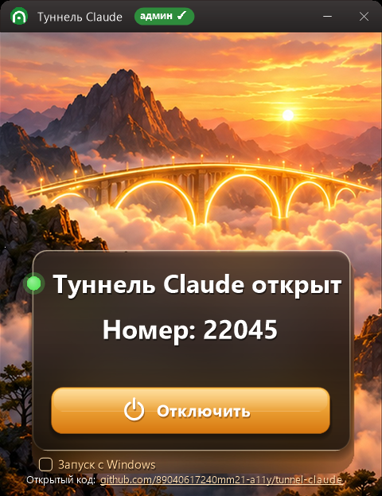
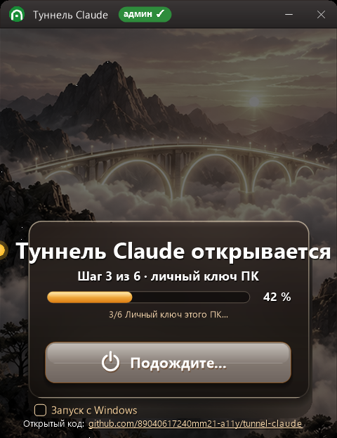

# Туннель Claude

**Проверка ПК на вирусы и безопасный удалённый доступ для обслуживания 1С — одна программа, открытый код.**

«Туннель Claude» делает две вещи:

- проверяет ПК на вирусы встроенным Защитником Windows: ничего не удаляет, только составляет отчёт;
- поднимает безопасный обратный SSH-туннель, чтобы специалист мог обслуживать 1С.

Клиент сам включает и выключает туннель одной кнопкой. Каждый вход специалиста записывается в журнал на рабочем столе.

Сайт проекта: https://89040617240mm21-a11y.github.io/tunnel-claude/

## Как выглядит (версия 103.5)

| Туннель открыт | Идёт установка |
|---|---|
|  |  |

Одно простое окно: статус, номер для специалиста и одна кнопка. При установке — «Шаг N из 6» и полоса с процентами. Крестик сворачивает программу в трей, галочка «Запуск с Windows» стоит по умолчанию. Номер на снимке — демонстрационный.

## Что умеет

- **Проверка на вирусы.** Сразу после установки запускается проверка Защитником Windows с ключом `-DisableRemediation`: ничего не удаляется и не попадает в карантин, получается только список находок. Проверка идёт фоном от SYSTEM и продолжается после перезагрузки.
- **Туннель без открытых портов.** ПК клиента сам держит исходящее SSH-соединение на сервер поддержки. На роутере ничего настраивать не нужно, внешний IP может меняться.
- **Клиент управляет сам.** Кнопки ВКЛЮЧИТЬ / ВЫКЛЮЧИТЬ / ПОЧИНИТЬ и крупный статус: поднят туннель или нет и почему.
- **Всё в журнале.** Файл «Журнал доступа Claude.txt» на рабочем столе: кто заходил, когда, откуда и что делал. Журнал написан простым текстом, его понимает и человек, и любой ИИ.
- **Только по ключу.** Вход только по ключам специалистов, пароли выключены. Ключ туннеля каждого ПК может открыть только свой порт на сервере.
- **Пинг до серверов** с флагами стран, Radmin VPN как запасной путь, снимок окна для специалиста.
- **Лог ошибок специалистам** (галочка в окне): текст запуска и установки, чтобы починить без звонка.
- Сам ставит и чинит OpenSSH. Знает про 360 Total Security, права на ключи, старые Windows 10 и ПК без DNS.

## Дорожная карта

- **103** — паспорт ПК (железо, Windows, 1С, диски) и полноценный антивирусный отчёт в окне;
- поддержка **Windows 7 / XP**;
- **обновления с сайта** — программа сама предлагает новую версию.

## Как это выглядит

```
ПК клиента ──(исходящий SSH)──► сервер поддержки ◄──(SSH по ключу)── специалист 1С
     │  Защитник Windows: отчёт без удаления
     └─ журнал на рабочем столе: кто, когда, откуда, что делал
```

## Для программистов: свой сервер за 15 минут

Программа не привязана к авторам: всё «своё» лежит в одном файле `profile.ini`. Это сервер, порт, отпечаток сервера, ключи специалистов и список серверов с флагами.

1. Поднимите сервер туннелей по инструкции [server/README.md](server/README.md). Нужны Windows Server и OpenSSH, отдельная служба `sshd_tunnel`, пользователи `claude_tunnel` и `claude_enroll` с `ForceCommand`.
2. Создайте ключ регистрации: `ssh-keygen -t ed25519 -f enroll_key -N '""'`.
3. Скопируйте `profile.example.ini` в `profile.ini` и впишите свои данные.
4. Соберите программу. Нужен только .NET Framework 4, он есть в любой Windows 10/11; Visual Studio не нужна:

   ```powershell
   powershell -ExecutionPolicy Bypass -File build.ps1
   ```

   Получится `TunnelClaude.exe` с вашим профилем внутри.

`profile.ini` и `enroll_key` закрыты в `.gitignore` и в репозиторий не попадают.

### Состав

| Путь | Что это |
|---|---|
| `src/TunnelGui.cs` | окно программы (C# 5, WinForms, один файл) |
| `installer/setup_core.ps1` | установка: OpenSSH, ключи, регистрация, задача туннеля, проверка Защитником |
| `installer/setup_suffix.ps1` | журнал входов на рабочем столе клиента |
| `server/` | скрипты и конфиг сервера туннелей, инструкция |
| `build.ps1` | сборка: подставляет профиль в `{{МЕТКИ}}` установщика и компилирует exe |
| `profile.example.ini` | пример профиля |
| `app.manifest`, `tunnel.ico`, `mkicon.ps1` | манифест (права администратора), значок и его генератор |
| `docs/` | сайт проекта (GitHub Pages) |

## Безопасность

- Ключ регистрации общий для всех копий и вшит в программу. Поэтому сервер разрешает ему только одно: получить порт. Есть лимиты: 50 регистраций в сутки, логи до 256 КБ.
- Туннель слушает только `127.0.0.1` сервера. Снаружи порт клиента не виден.
- Клиент в любой момент выключает туннель кнопкой или в Планировщике заданий.
- Нашли уязвимость — напишите нам (контакты ниже), не в открытые Issues.

## Контакты

WhatsApp / MAX / Телеграм **+7 904 061-72-40**, 24/7. Консультация бесплатно.

## Лицензия

MIT © 2026 Mikhail Novikov
